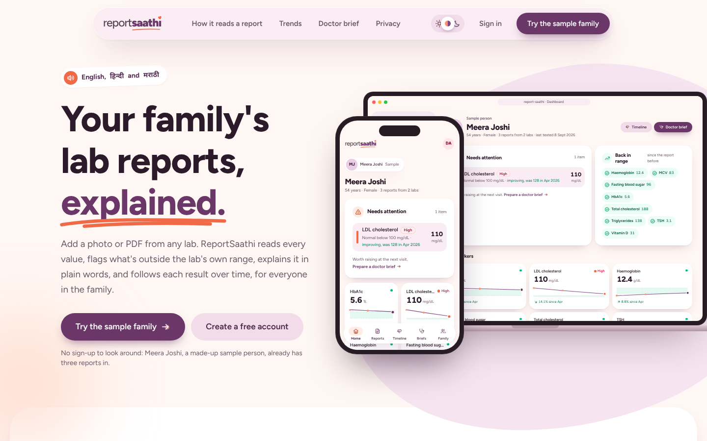
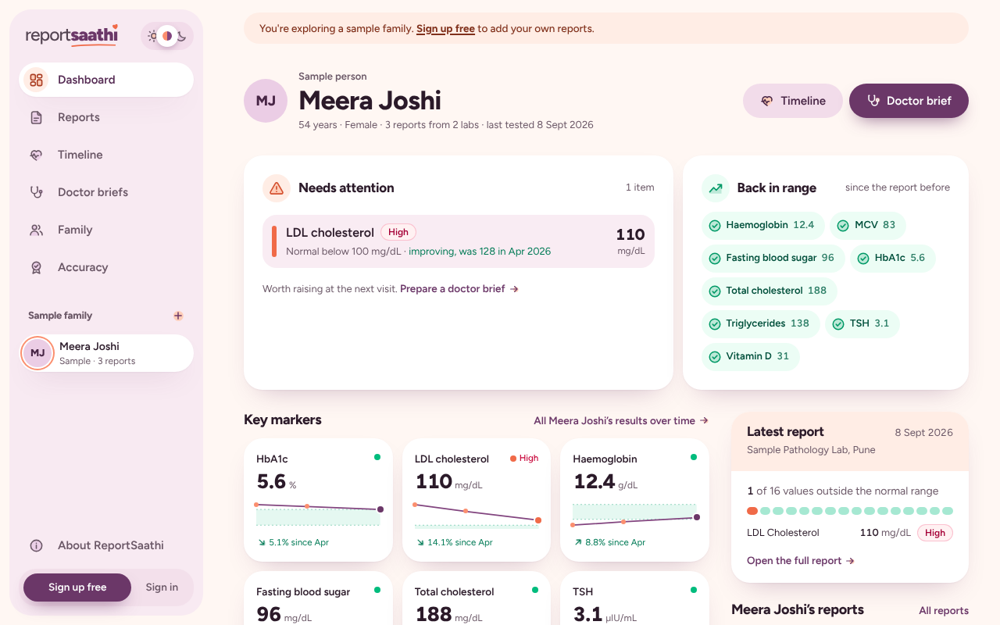
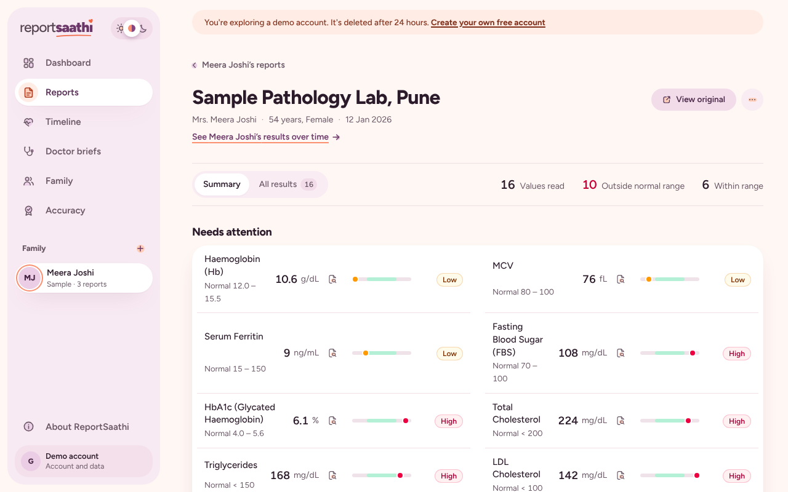
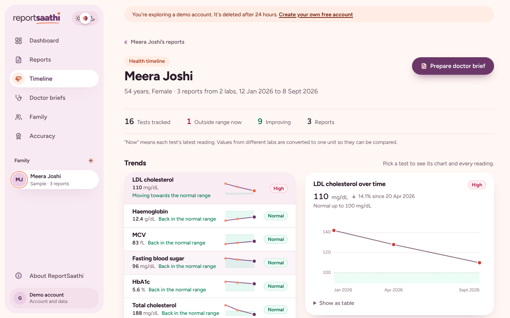
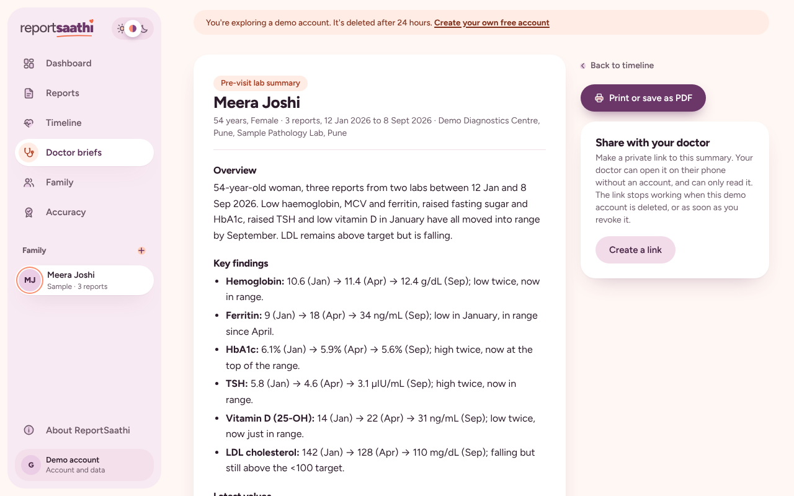
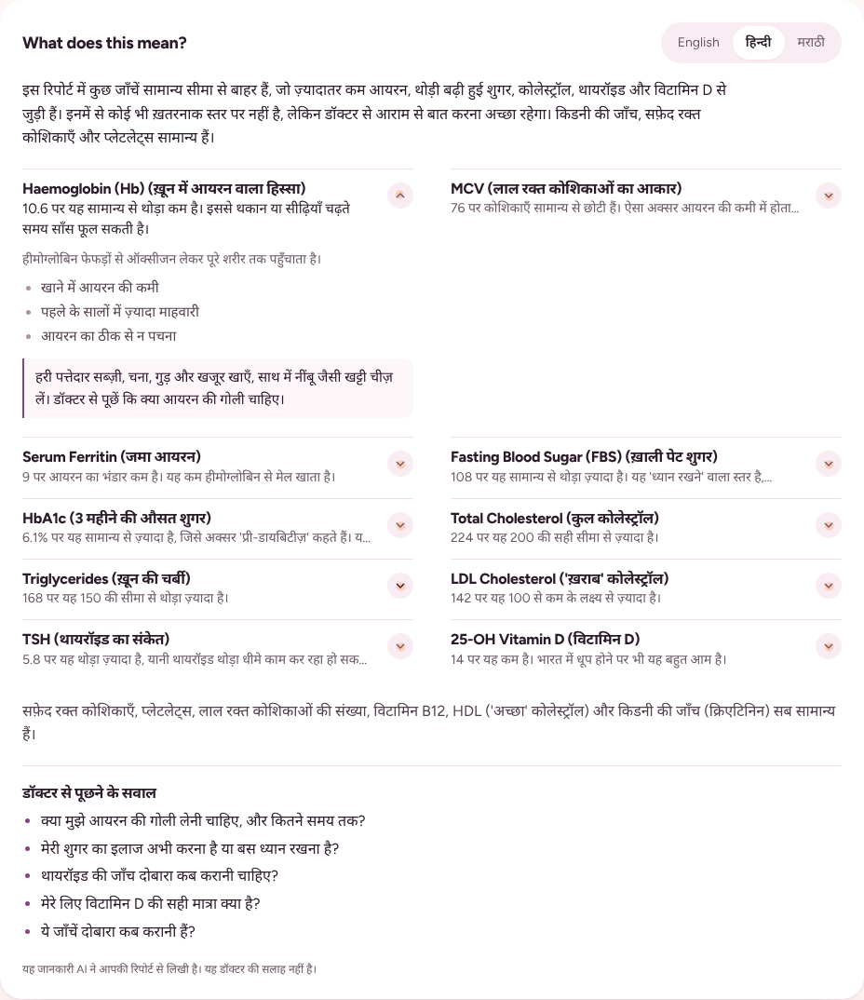
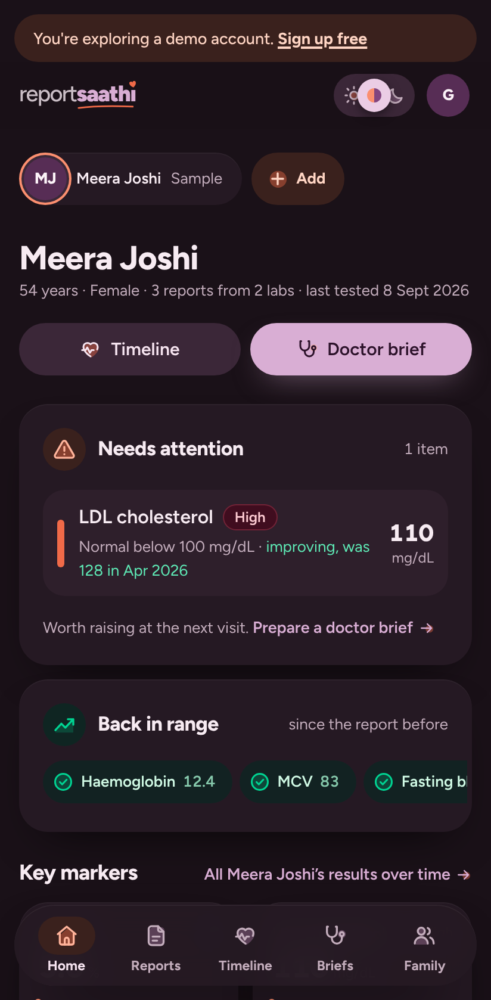
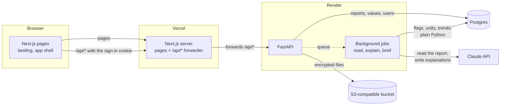

# ReportSaathi

**Live site: [report-saathi-six.vercel.app](https://report-saathi-six.vercel.app)** · open the app straight
away at [/dashboard](https://report-saathi-six.vercel.app/dashboard), no sign-up needed.

[](https://github.com/whatalshifa/report-saathi/actions/workflows/ci.yml)
[](LICENSE)

Your family's lab reports, explained. Add a PDF or a phone photo of a lab report from any Indian lab.
ReportSaathi reads every value, flags the ones outside the lab's own range, explains them in plain
English, Hindi or Marathi, and lines up reports from different labs into one timeline you can take to
your doctor. Every value links back to the exact spot on the report it was read from, so you can check
the AI instead of trusting it.

> **Honest note: the live site runs in demo mode.** Reading new reports needs an Anthropic API key, and
> the public deployment has none, so uploads are paused there. Everything else works on Meera, a
> made-up person with three sample reports from two labs; her explanations and doctor brief were written
> in advance. Set `ANTHROPIC_API_KEY` on the API and uploads switch on. The API also sleeps on Render's
> free plan when idle: the first visit outside office hours can take about 50 seconds, and the site says
> so while it waits.



| The app's dashboard | A report, explained |
|---|---|
|  |  |
| **One timeline across labs** | **A one-page doctor brief** |
|  |  |
| **Explanations in Hindi (and Marathi)** | **On a phone, in dark mode** |
|  |  |

## What it does

- **Reads any lab report.** Claude reads every page and returns each test as structured data. Plain
  Python, not the AI, decides whether a value is low, high or normal, against the range the lab printed.
- **Shows where every number came from.** One tap opens the original report with that value
  highlighted. A misread value can be fixed, and every fix is logged for the accuracy test.
- **One timeline across labs.** "Hb 13.4 g/dL", "HGB 128 g/L" and "Hemoglobin 12.4 gm%" are recognised
  as the same test, using a catalog of 229 tests with LOINC codes, converted to one unit and drawn as
  trend charts against the normal range.
- **Explanations in three languages,** read aloud on request, and a one-page **doctor brief** that can be
  printed, saved as a PDF or shared as a private, expiring link or QR code.
- **The whole family, privately.** One account holds profiles for parents and children, and warns when a
  report's name doesn't match the person it was filed under. Files are encrypted with their own keys
  (AES-256-GCM envelope encryption), and people can download or delete all their data, as India's DPDP
  Act requires.
- **Installable.** On Android it can be added to the home screen and appears in WhatsApp's "Share to"
  menu, so a report a lab sends on WhatsApp goes straight in.

The full feature list, phase by phase, is in [docs/FEATURES.md](docs/FEATURES.md).

## The site

| Route | What's there |
|---|---|
| `/` | The landing page: the product explained with Meera's real sample report, trends and brief |
| `/dashboard` | The app. Signed out, it opens on the sample family at once; the first click into a report starts a private demo account (deleted after 24 hours) |
| `/reports`, `/reports/[id]` | Every report in the family; one report's summary, all results, the original file and the explanation |
| `/profiles/[id]` | A person's health timeline: every test across labs, with trend charts |
| `/briefs`, `/briefs/[id]` | Doctor briefs, with print and private share links |
| `/family`, `/account` | Family members; the account, "download all my data" and delete |
| `/shared#<token>` | What a doctor opens from a share link, without an account |
| `/accuracy`, `/privacy` | How reading accuracy is measured; what is kept and why |

## Built with

- **Website:** Next.js 16 (App Router), React 19, TypeScript, Tailwind CSS 4. No UI kit: the wordmark,
  icons and components are drawn for this product. Hosted on Vercel.
- **API:** Python 3.11, FastAPI, SQLAlchemy 2, Alembic, pdfplumber. Hosted on Render (Docker).
- **AI:** Claude through the Anthropic API (vision and structured outputs).
- **Data:** Postgres and an S3-compatible bucket on Neon; SQLite and a local folder in development.
- **Quality:** pytest, ruff, ESLint (with jsx-a11y), Playwright with axe, GitHub Actions, optional Sentry.

## Architecture



The browser only ever talks to the website, which forwards `/api/*` to FastAPI
(`frontend/next.config.ts`), so the sign-in cookie is first-party and there is no CORS to set up. An
upload is checked by its bytes, encrypted and saved, and the API answers at once; a background job sends
it to Claude, then plain Python flags each value, matches it to the test catalog and converts units. The
page polls until the report is ready. Timelines are computed by code; explanations and briefs are written
by Claude.

The full walkthrough, written for someone new to these tools, is in
[docs/ARCHITECTURE.md](docs/ARCHITECTURE.md). Why each technology was picked is in
[docs/DECISIONS.md](docs/DECISIONS.md).

## Run it locally

You need Python 3.11+ and Node 22+. An Anthropic API key is optional: without one the app runs in demo
mode, exactly like the live site.

**Backend** (terminal 1):

```bash
cd backend
python -m venv .venv && source .venv/bin/activate   # Windows: .venv\Scripts\activate
pip install -r requirements-dev.txt
cp .env.example .env          # optional: add ANTHROPIC_API_KEY to read real uploads
alembic upgrade head          # creates the database tables (SQLite)
uvicorn app.main:app --reload # API on http://localhost:8000, interactive docs at /docs
```

**Frontend** (terminal 2):

```bash
cd frontend
npm install
cp .env.example .env.local
npm run dev                   # http://localhost:3000
```

Open http://localhost:3000 and choose **Try the sample family**, or create an account and add the
sample reports from the dashboard.

In development an encryption key for uploaded files is created in `backend/.dev-master-key`. Keep it:
without it, saved files can't be opened. In production set `RS_MASTER_KEY` and `RS_ENV=production`.
Every setting is listed in `backend/.env.example` and `frontend/.env.example`.

**Or everything with Docker** (also starts Postgres):

```bash
cp backend/.env.example backend/.env
docker compose up --build     # http://localhost:3000
```

## Testing

```bash
cd backend && ruff check . && pytest       # 336 tests
cd frontend && npm run lint && npm run build
cd frontend && npx playwright test         # 46 browser tests, 88 runs on a computer and a phone
```

- **Backend unit and API tests (pytest)** cover what must never be wrong: flagging against printed
  ranges, unit conversion, trends, sign-in and lockout, ownership checks on every endpoint, encryption,
  share links, demo accounts, rate limits, data export and consent. They use a stand-in for Claude, so
  they are free, fast and deterministic.
- **Browser tests (Playwright)** drive the real website against the real API in demo mode, on a desktop
  and a Pixel 7 screen: the first-visit path from the landing page into the app, explanations in Hindi,
  fixing a misread value, tracing a value to the original, sharing a brief and revoking it, installing
  the app, the WhatsApp share flow, 404s, an API that is down, page titles and share previews. axe checks
  the landing page against WCAG 2.1 AA in light and dark mode, and layout tests catch sideways scrolling
  on phones, pages that jump while they load, and pages taller than about two screens.
- **Reading accuracy** on real reports is measured separately with hand-checked answers; see
  [docs/ACCURACY.md](docs/ACCURACY.md).

GitHub Actions runs all of this on every push and pull request, plus the database migrations against a
real Postgres.

## Deploying

[docs/DEPLOY.md](docs/DEPLOY.md) covers every setting and two routes: Render + Vercel + Neon on free
tiers, or AWS (Amplify, App Runner, RDS, S3, KMS). A scheduled workflow
(`.github/workflows/keep-warm.yml`) keeps the free API awake on weekdays from 09:30 to 18:30 IST.

## Project layout

```
backend/
  app/
    main.py               FastAPI app, health check
    api/                  auth, demo, profiles, reports, shares; deps.py holds the ownership checks
    services/             reading (extraction, claude, processing, jobs), flagging, catalog, trends,
                          writing (explanations, briefs), crypto, storage, sharing, export, names, ...
    models.py, schemas.py database tables and the JSON shapes the API returns
  alembic/                database migrations
  accuracy/               the accuracy test on real reports
  tests/                  pytest
frontend/
  src/app/                routes: the landing page (/), the app (/dashboard and the rest), error,
                          loading and 404 pages, the share image, icons, manifest, robots and sitemap
  src/components/         the app's screens and shared pieces
  src/components/shell/   the app frame: sidebar, phone tab bar, the signed-in or sample-family state
  src/components/landing/ the landing page's product demos
  src/lib/api.ts          typed calls to the backend, with retries while a sleeping server wakes
  src/proxy.ts            sends signed-out visitors to sign in before a private page
  e2e/                    Playwright tests
docs/                     architecture, decisions, deploying, accuracy, features, screenshots
```

## Disclaimer

ReportSaathi is a learning project. It can misread a report, and it is not medical advice.
